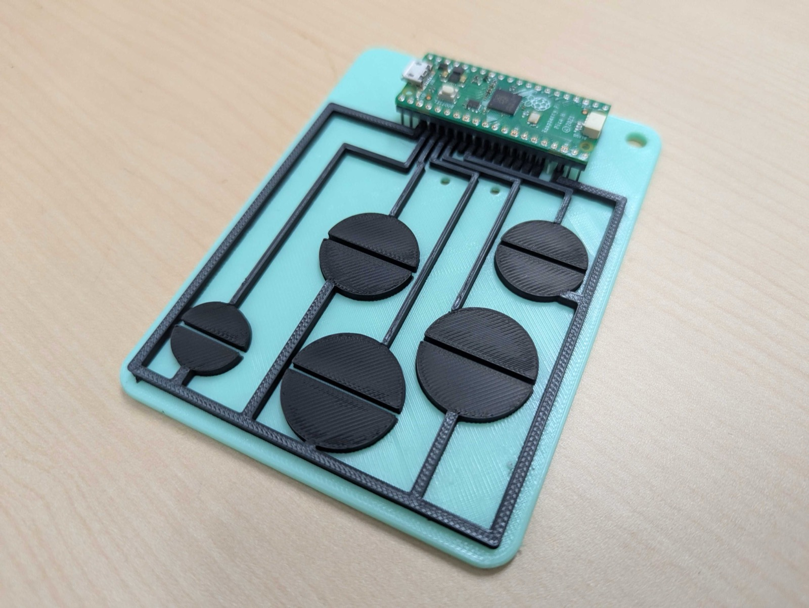
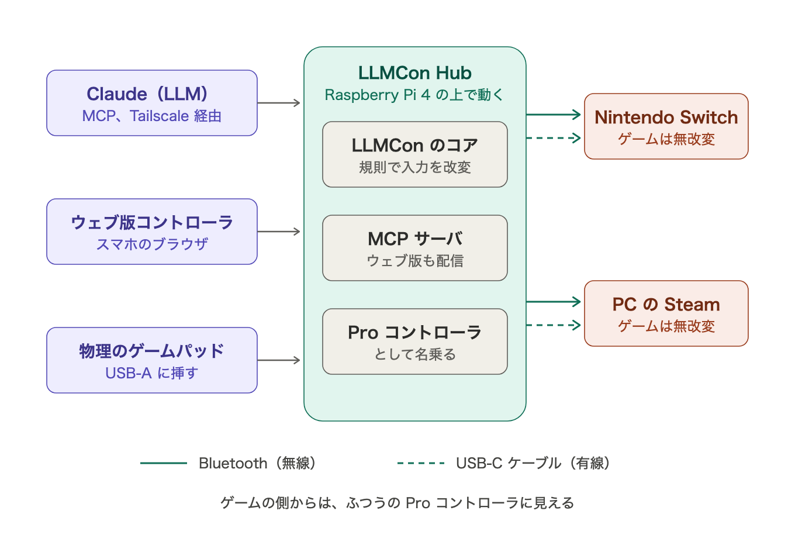

# 参考動画

`llmcon_wiss2026.mp4` は、WISS 2026 に論文を投稿した時点（2026年8月）の9つの応用事例が実際に動いている様子である。
3分27秒。https://unryu.org/LLMCon/video/llmcon_wiss2026.mp4 を開くと、ブラウザで再生できる（GitHub Pages から配信している）。

採録後の最終版の論文では、5章の事例を6つに絞った。この動画は投稿時のものをそのまま置いているので、
最終版の論文に残した6つの事例のほかに、最終版で外した3つの事例も映っている。
下の表は、動画の場面と最終版の論文の節との対応である。

| 最終版の論文の節 | 動画の場面 |
|---|---|
| 5.1 一人用ゲームの難易度調整 | 画面を見て調整するLLM審判 |
| 5.2 対人ゲームのスキル差調整 | 上級者にハンディキャップを課す |
| 5.3 異なるゲームの接続 | アステロイドのコマンドがテトリスの回転を止める |
| 5.4 アクセシビリティの向上 | 片手で遊べるようにする（下の注を読むこと） |
| 5.5 ゲーミフィケーション | 撃つには計算に正答する／強い技を使うほど寄付になる |

最終版の論文から外した3つの事例は、投稿時の事例として動画に残してある。
投稿時の論文では、「徐々に狙いにくくする」と「自分の入力が自分を制約する」を5.1節で、
「一人の行動を全員へ配る」を5.3節で述べていた。

5.4節の場面についての注。投稿時の事例では、大規模言語モデルがゲームの実装を調べて、必要な入力を特定していた。
最終版の論文の5.4節では、ゲームのソースコードを参照させずに同じ依頼を与え、
大規模言語モデルが画面の表示とテトリスの一般的な知識から入力を特定して、右手用のインタフェースを設計した事例に置き換えた。
動画に映っているのは、投稿時の事例のほうである。

最終版の論文の5.6節（市販ゲームへの適用）の場面は、この動画には含まれていない。

事例で用いたゲームの権利については、リポジトリの根にある NOTICE.md を読むこと。

## Finalize Fantasy with LLMCon

`finalize_fantasy_with_llmcon_v3.mp4` は、LLMCon の活用事例として、ゲームをやめやすくするタイマー Finalize Fantasy
（https://protopedia.net/prototype/6687 ）を LLMCon の上で作り直したものが動いている様子である（2026年10月に作成）。
3分23秒。https://unryu.org/LLMCon/video/finalize_fantasy_with_llmcon_v3.mp4 を開くと、ブラウザで再生できる（GitHub Pages から配信している）。論文には含まれていない事例である。

終了予定の時刻が近づくと、大規模言語モデルが画面から推定したゲームに合わせて作った制限の候補を、本人が選び、
LLMCon がその制限をコントローラの層で掛ける。テトリス、スペースインベーダー、アステロイドの3つのゲームで、
同じ仕組みのまま、ゲームごとに異なる制限が掛かる様子を収めている。

動画の画面の上の段は実際の画面（左がゲーム、右が Finalize Fantasy のダッシュボード）で、
下の段は動画のために加えた解説である。決まった手順で遊ぶ自動プレイヤ（大規模言語モデルではない）がゲームを遊び、
意図どおりに操作できた割合を数えている。動画の中の時間は、6倍の速さで進めている。

## 導電性の右手テトリスコントローラ

`conductive_tetris_controller.jpg` は、最終版の論文の5.4節の事例（右手だけでテトリスを遊べるようにする）で
大規模言語モデルが設計した右手用のコントローラを、印刷して実物にしたものの写真である（2026年10月に作成）。
論文には含まれていない事例である。

`conductive_tetris_controller_play.mp4` は、このコントローラでテトリスを遊んでいるところを撮った短い動画である（13秒、2026年11月に撮影）。
https://unryu.org/LLMCon/video/conductive_tetris_controller_play.mp4 を開くと、ブラウザで再生できる（GitHub Pages から配信している）。

論文の5.4節では、大規模言語モデル（Claude Opus 5）が、テトリスに要る5つの入力（左へ移動、右へ移動、回転、1マス落とす、開始）
だけを備えた右手用のコントローラを、ウェブ版の仮想コントローラとして設計した。
この仮想コントローラを、姉妹プロジェクト「印刷するゲームコントローラ」（https://protopedia.net/prototype/9667 ）の成果を使って、
同じ寸法の物理的なコントローラにした。印刷するゲームコントローラは、導電性フィラメントで配線とタッチ式のボタンを一体に印刷し、
Raspberry Pi Pico を差し込むだけで使えるコントローラである。

作った手順は次のとおりである。

1. 仮想コントローラの HTML から、5つのボタンの位置と直径を読み取り、レイアウトの設計データにする。
2. 配線を自動で引き、配線の交差、短絡、抵抗の余裕を検査する。
3. 約 91×122mm の板を、Bambu Lab A1 mini で約1時間30分かけて印刷する。
4. Raspberry Pi Pico を差し込み、このボタンの割り当てを焼き込んだファームウェアを書き込む。

写真の黒い部分が導電性フィラメントの配線とボタンで、ミントグリーンの部分が非導電の板である。
2026年11月に実物を Mac につなぎ、5つのボタンがすべて反応して、テトリスを遊べることを確かめた。
最初は、Pico を差し込むソケットの部分で、GND のピンと隣の信号のピンが、導電性フィラメントのわずかな残りで約 2kΩ でつながっていた。
このつながりをカッターで取り除いてから、正しく動いた。

## ストリートファイター6での2つの事例（AI ハンディキャップとカジュアル音声操作）

`sf6_llmcon_intro.mp4` は、LLMCon を市販の対戦格闘ゲーム「ストリートファイター6」（© CAPCOM）に使った
2つの事例が、実機で動いている様子である（2026年10月に作成）。
4分23秒。https://unryu.org/LLMCon/video/sf6_llmcon_intro.mp4 を開くと、ブラウザで再生できる（GitHub Pages から配信している）。

どちらの事例でも、ゲームには一切手を加えていない。LLMCon が、手元のアーケードコントローラとゲームのあいだで、
入力を書き換えているだけである。

**AI ハンディキャップ** … 判定AIが画面から場面を見分け、両者の体力を画面の色で測る。体力の差が開くと、
勝っている側のボタンを封じる。観客向けのダッシュボードが、判断の理由を説明し、読み上げる。
観客や対戦者がハンデへの要望を送ると、制御の大規模言語モデルがハンデの掛け方を変える。
動画では、ハンデが掛かり始める体力の差を変える、ボタンを封じる代わりに入力を80ミリ秒遅らせる、
3秒動けなくする、弱パンチを4秒連打させる、といった要望に応えている。

**カジュアル音声操作** … 画面を見ずに、言葉で自分のキャラクタを動かす。技の名前が入った指示は、
技の一覧と照合して、大規模言語モデルを通さずにすぐ実行する。決まらなければ判定AIが技を選び、
大まかな指示は、制御の大規模言語モデルが技の入力の並びを組み立てる。一覧に無い技（投げ、ドライブインパクト）は、
大規模言語モデルがストリートファイター6の知識から入力の並びを作り、新しい技として覚える。
画面を見なくても、コントローラを細かく操作しなくても遊べるので、ゲームのアクセシビリティの向上に貢献する。

動画の中の実演では、要望や指示を文字の欄に打ち込んでいる。どちらの事例でも、マイクで話しかけた声は、
文字で打ち込んだときと同じ経路で届く。このことは、動画の中の図の場面で説明している。

実演の場面では、画面の左がゲーム、右が各事例のダッシュボードである。
ゲームと LLMCon は ROG Ally X で動かし、制御の大規模言語モデル（Claude Sonnet 5.5）と判定AIは、別の Mac で動かしている。

ゲームの画面の権利は株式会社カプコンにある。この動画と、下の Jump King の動画では、事例の動作を示すためにゲームの画面を含めている。
詳しくは、リポジトリの根にある NOTICE.md を読むこと。

## Jump King の自動攻略（AI が Jump King に挑む）

`jumpking_llmcon_autoplay_v2.mp4` は、LLMCon と大規模言語モデル（Claude）を使って、市販の登山ゲーム「Jump King」（Nexile）を、
ゲームのソースコードに触れずに外から自動で攻略した事例の、すべての試行をつないだダイジェストである（2026年10月に作成）。
3分38秒。https://unryu.org/LLMCon/video/jumpking_llmcon_autoplay_v2.mp4 を開くと、ブラウザで再生できる（GitHub Pages から配信している）。
論文には含まれていない事例である。

Jump King では、ボタンを押す長さ（溜め）で跳ぶ高さと距離が決まり、王が落ちると何画面も下まで戻される。
この事例では、役割を次のように分けた。

- **Claude**（大規模言語モデル）は、一手ずつボタンを押すのではなく、自動攻略のプログラムを書き、直し、見守る。
- **自動攻略のプログラム**は、画面から王の位置を読み、第三者が公開している模擬環境 jumpking-rl で跳び方を計算する。
- **LLMCon** は、ボタンを押す長さを60分の1秒のコマ単位で再現して、ゲームへ入力する。段階19の2回の試行の1,165回の跳躍では、
  計画した溜めと、ゲームが表示した溜めのコマ数との違いが、99.4% の跳躍で1コマ以内であった（ぴったり一致したのは 83.3%）。

Claude は、ゲームのソースコードの代わりに、インターネットで公開されている知識を使った。
第三者が移植して公開した模擬環境 jumpking-rl（https://github.com/TranBaDat2607/jumpking-rl 、MIT ライセンス）と、それに同梱の TAS 由来の通し経路、
Steam ワークショップの MOD（Jump King Manager、level%、jump%、player coordinates）である。
ゲームのコードとデータには手を加えていない。

動画は3つの章からなる。

1. **MODなし** … 自動攻略を始めてから頂上に着くまで、Claude がプログラムを直しながら、約33時間かかった。
   プログラムが画面の番号を数え違え、王が1時間半同じところで落ち続けた場面と、それに栗原が気づいた場面を含む。
2. **MOD活用** … 位置を保存して戻せる MOD（Jump King Manager）を使うと、落ちた王を戻す待ちが、1回あたり約57秒から約0.7秒になった。
   画面1から頂上まで1時間15分であった。2回目の挑戦で王が31分足踏みしたときは、Claude が自分で原因を突き止めて、プログラムを3回直した。
3. **同じ条件で何回も登る** … プログラムを固定して、同じ条件で画面1から頂上までを繰り返した。2回目から11回目の10回は、
   Claude も人も一度も手を出さずに、10回とも頂上に着いた（平均1時間05分10秒、最も速い回は34分41秒）。
   動画は6回目までが終わった時点で作ったので、読み上げでは「2回目から6回目までの5回」と述べている。

試行の場面では、画面の左がゲームで、右に試行の数値と、作業の記録の Issue で実際に交わした発言を、チャットの画面のような形で出している。
発言の主は、栗原、ROG Ally の Claude（ゲームを動かし、プログラムを書いたセッション）、omba の Claude（栗原と話し、依頼を書いたセッション）である。
Claude の判断（プログラムの直しなど）と、プログラムの自動の切り替えは、発言とは別の枠で出している。
ゲーム、LLMCon、自動攻略のプログラムは ROG Ally X で動かした。

ゲームの画面の権利は Nexile にある。詳しくは、リポジトリの根にある NOTICE.md を読むこと。
締めのクレジットの背景は、段階19の2回目の録画の、頂上の画面43（夕日と姫）のコマである（MOD の表示の文字は消した）。
読み上げの声は VOICEVOX:ずんだもん、背景音楽は "Pixel Peeker Polka - slower" Kevin MacLeod（incompetech.com、CC BY 4.0）である。

## TetWISS 2026（議論の活発さで、発表ごとのテトリスが上手くなる）

`tetwiss2026_with_llmcon.mp4` は、学会の議論の活性化と可視化のために、LLMCon を使って作った企画 TetWISS 2026 の仕組みを、
過去の WISS の書き込みの記録で動かした様子である（2026年10月に作成）。
3分16秒。https://unryu.org/LLMCon/video/tetwiss2026_with_llmcon.mp4 を開くと、ブラウザで再生できる（GitHub Pages から配信している）。
論文には含まれていない事例であり、**WISS 2026 で運用すべく申請中**である（WISS Challenge に応募した）。

TetWISS 2026 では、登壇発表ごとにテトリスを1つずつ割り当て、会期中に同時に自動プレイヤに遊ばせる。
各発表の cosense のページへの参加者の書き込みが、その発表のテトリスのエネルギーとして貯まり、
自動プレイヤはブロックを1つ置くごとにエネルギーを消費する。LLMCon は、エネルギーの残りに応じて、
自動プレイヤの入力に反応の遅れを加える。エネルギーが十分にあるあいだは遅れを外すので、議論が活発な発表ほど、
テトリスのハイスコアが伸びる。参加者はゲームを操作せず、普段どおり発表を聴いて議論を書き込めばよい。

この動画では、WISS 2025 の登壇発表9件の cosense の書き込みの記録（行の作成時刻と件数だけを集計したもの）をエネルギーとして使い、
各発表の発表と質疑の20分を2分に縮めて順に再生した。動画の中の時間は、さらに8倍の速さで進めている。
エネルギーの段階ごとの反応の遅れ（0〜250ミリ秒）は、大規模言語モデル（Claude Opus）が予備実験の結果から前もって決めた。
テトリスは、大規模言語モデルが実装した自動プレイヤが、画面の画像だけを読んで遊んでいる。
書き込みの多かった2件の発表のテトリスが、ハイスコアの1位と2位になった。

テトリスは、jakesgordon/javascript-tetris（MIT ライセンス）と同じ遊びを、多数を同時に動かすためにブラウザを使わずに再現したもので動かした。
テトリスと LLMCon と自動プレイヤは、すべて1台の Mac で動かした。読み上げの声は VOICEVOX:玄野武宏である。

## 落ち物パズル異種格闘技戦（別々の落ち物パズルを、妨害でつないで対戦する）

`fallblock_versus_llmcon_v2.mp4` は、LLMCon を使って、別々の既存の落ち物パズルをつなぎ、対戦のゲームにした事例の様子である（2026年11月に作成）。
2分38秒。https://unryu.org/LLMCon/video/fallblock_versus_llmcon_v2.mp4 を開くと、ブラウザで再生できる（GitHub Pages から配信している）。
論文には含まれていない事例である。

使うのは、テトリス、ぷよぷよ、コラムス、ドクターマリオ風のゲームの、公開されている再実装4つである。どのゲームのコードにも手を加えていない。
試合を始めるたびに、1P と 2P のゲームをくじで選ぶ（1P と 2P には別々のゲームが選ばれ、直前の試合と同じ組み合わせは避ける）。
片方が行を消したり連鎖したりすると、LLMCon が相手のコントローラに、消した量に応じた秒数だけ妨害を掛ける。妨害は次の4種類である。

- **落下を急がせる** … LLMCon が下のボタンを勝手に連打し、ブロックが速く落ちる。
- **回転を封じる** … LLMCon が回転のボタンを無効にする。
- **操作を遅らせる** … LLMCon がすべての操作を0.35秒遅らせて届ける。
- **回転が止まらない** … LLMCon が回転のボタンを勝手に連打し、ブロックが回り続ける。

ゲームごとの違い（キーの割り当て、行を消したことや連鎖の読み取り方）は、大規模言語モデル（Claude）が、ゲームごとの小さな差し込み口として書いた。
差し込み口は、ゲームのページの外から、ゲームの変数や画面の数字を読むだけである。

動画では、盤面を読んで置き場所を決める自動プレイヤ（大規模言語モデルではない）が、1P と 2P の両方を遊んでいる。
ゲームの上の2行の点灯は、上がプレイヤの入力、下が LLMCon を通ったあとの入力である。
妨害を受けている側を囲む赤い枠と、妨害の名前の札は、動画のために加えた表示である。
ゲームと LLMCon（1P と 2P に1つずつ）と自動プレイヤは、すべて1台の Mac で動かした。読み上げの声は VOICEVOX:玄野武宏である。

使ったゲームの配布元とライセンスは、リポジトリの根にある NOTICE.md に書いた。

## LLMCon Hub（Raspberry Pi で LLMCon を動かし、ふつうのコントローラとしてゲーム機や PC につなぐ）

LLMCon Hub は、LLMCon を小さなコンピュータ（Raspberry Pi 4）の上で動かし、Raspberry Pi そのものを Nintendo Switch の Pro コントローラとして、ゲーム機や PC につなぐためのものである（2026年11月に作成）。
論文には含まれていない、LLMCon の本体を広げるサブプロジェクトである。

これまでの LLMCon は、Windows の PC の中で仮想の Xbox 360 コントローラを作っていた。
LLMCon Hub は、LLMCon を物理のゲームパッドとゲーム機のあいだに挟む、独立した1つの機器にした。そのため、ゲームを動かす機械の上で LLMCon を動かさなくても、Switch や別の PC のゲームを拡張できる。

物理のゲームパッド、スマートフォンのブラウザのウェブ版コントローラ、大規模言語モデル（Claude）からの入力を1か所に集め、LLMCon のコアがこれまでと同じ規則で改変してから、Bluetooth か USB ケーブルでゲーム機や PC へ出す。
大規模言語モデルは、別の機械から MCP で規則を伝える。Tailscale を通せば、離れた場所からでも届く。
ゲームの側からは、ふつうの Pro コントローラに見える。ゲームにも、ゲーム機や PC にも、手を加えない。

2026年11月2日の時点で、次のことを確かめた。

- Bluetooth で Windows の PC（ROG Ally）につなぎ、Steam が「Nintendo Switch Pro Controller」として認識した。
- Steam から起動したストリートファイター6 で、MCP から送ったボタンと十字キーが効いた。
- Raspberry Pi の中で、LLMCon の状態を Bluetooth の部品に渡すまでの時間は、60回の試行で中央値約1ミリ秒であった。

Nintendo Switch との接続、USB ケーブルでの接続、物理のゲームパッドの経路は、これから確かめる。上の図は、これらがすべて動いたときの姿である。
実装は、このリポジトリに追って加える。
